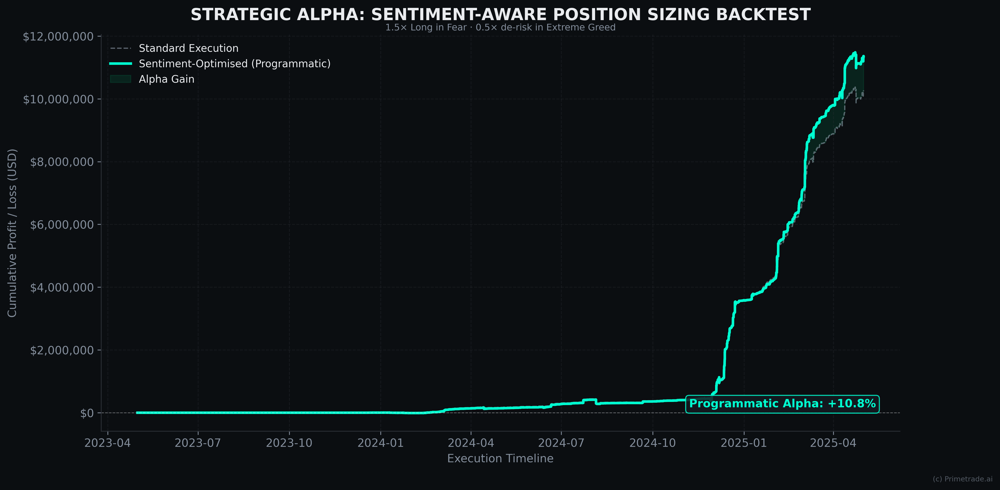
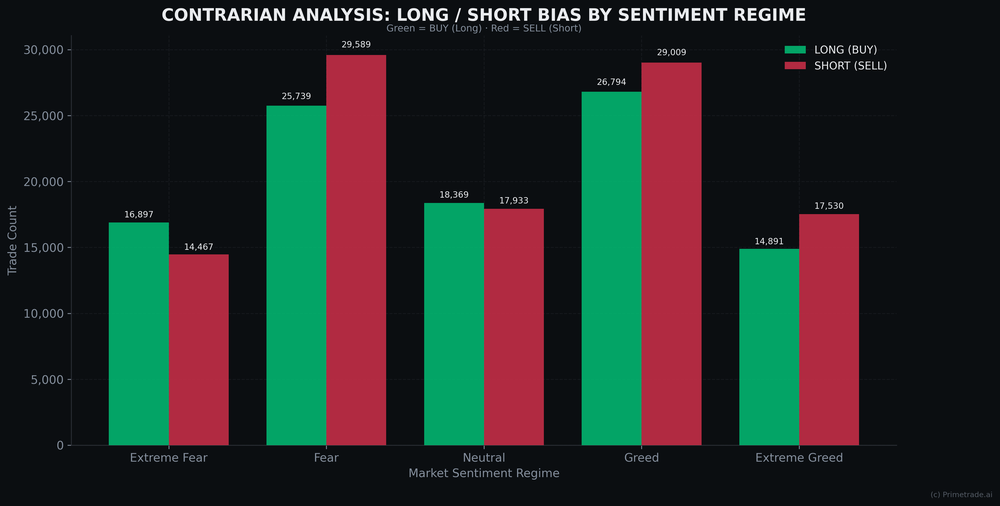

# Trader Performance and Market Sentiment

Do crypto traders trade differently when the market is fearful or greedy, and does that change their results? This project joins about 211,000 Hyperliquid trades (May 2023 to May 2025) with the daily Bitcoin Fear & Greed Index, tags every trade with a sentiment regime, and compares PnL, trade size and the long/short mix across regimes. It also tests a simple rule that sizes positions by sentiment.

## Approach

### 1. Data and merge
- `historical_data.csv`: 211,224 Hyperliquid trade records from 32 accounts, May 2023 to May 2025
- `fear_greed_index.csv`: 2,644 daily Bitcoin Fear & Greed readings
- IST timestamps are parsed to dates and inner-joined with the index on date, which keeps 211,218 rows (6 were dropped in parsing and the join)

### 2. Sentiment regimes
Each trade gets a regime from that day's Fear & Greed score:

| Score | Regime |
|-------|--------|
| 0 – 25 | Extreme Fear |
| 26 – 45 | Fear |
| 46 – 55 | Neutral |
| 56 – 75 | Greed |
| 76 – 100 | Extreme Greed |

### 3. Metrics
- Win rate and a Sortino-style ratio per account (average PnL divided by the standard deviation of losing trades)
- Buy and sell trade counts per regime
- Average trade size by hour of day (IST) and regime
- A leverage proxy of trade size ÷ 1,000. The dataset has no leverage column, so this is a rough stand-in, not true leverage.

### 4. Sentiment sizing rule
- 1.5× on buy trades in Fear and Extreme Fear
- 0.5× on buy trades in Extreme Greed
- 1.0× everywhere else

The rule is tested by re-weighting each trade's realised PnL with these multipliers and comparing the cumulative total with the unweighted one.

## Results

All numbers below come from the charts in `outputs/`, which the pipeline generates.

- **Sizing rule:** the re-weighted cumulative PnL ends about **10.8%** above the unweighted total. This is an in-sample re-weighting of trades that already happened, with no fees or slippage, so it shows the rule is worth testing properly, not that it would make money.
- **Long/short mix:** buys and sells stay close to even in every regime. Buys are 54% of trades in Extreme Fear, 47% in Fear, 51% in Neutral, 48% in Greed and 46% in Extreme Greed.
- **Trade size by hour:** the largest average trade sizes show up during Fear, around 21:00 to 22:00 IST.





The other charts cover the cumulative PnL curve, PnL distribution by regime, trade size against the index score, win rate against the Sortino-style ratio per account, and the leverage proxy by regime and tier.

## How to run

The source CSVs aren't committed (about 93 MB combined). Put `historical_data.csv` and `fear_greed_index.csv` in a `data/` folder at the repo root, then:

```bash
# Python 3.10+
pip install -r requirements.txt

# Regenerate all 9 charts
python notebooks/master_analysis.py

# Or step through the notebook
jupyter notebook notebooks/notebook_1.ipynb
```

Tech: Python, pandas, NumPy, matplotlib, seaborn, SciPy, Jupyter. No external APIs, so it runs offline.

## Project structure

```
├── notebooks/
│   ├── notebook_1.ipynb      # Step-by-step analysis
│   ├── master_analysis.py    # Same pipeline as a script (runs from any directory)
│   └── visualizer.py         # PrimetradeVisualizer class that draws the 9 charts
├── outputs/                  # The 9 charts (300 DPI PNGs)
│   ├── cumulative_pnl_pro.png
│   ├── pnl_distribution_regimes_pro.png
│   ├── size_heatmap_hourly_pro.png
│   ├── size_vs_sentiment_pro.png
│   ├── alpha_metrics_pro.png
│   ├── long_short_bias_pro.png
│   ├── leverage_distribution_pro.png
│   ├── leverage_performance_pro.png
│   └── programmatic_backtest_pro.png
└── requirements.txt
```

---

Built by [Aryan Panwar](https://aryanpanwar.in).
